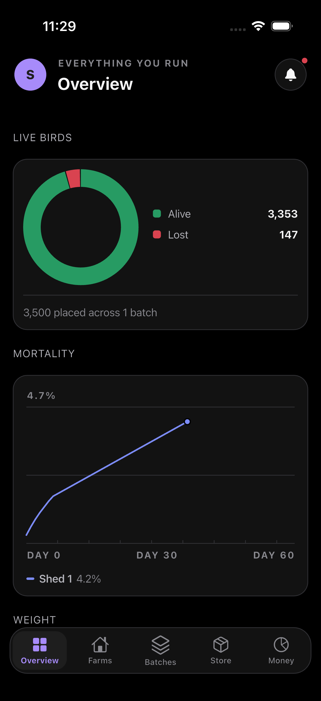
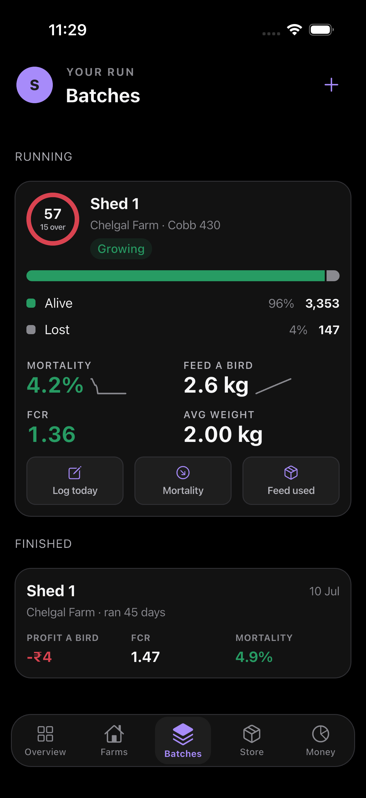
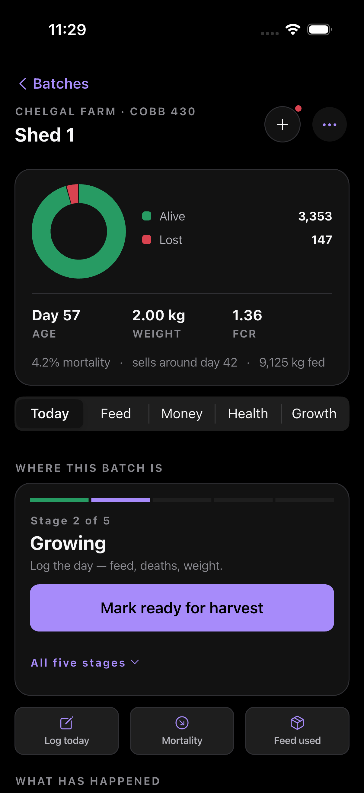
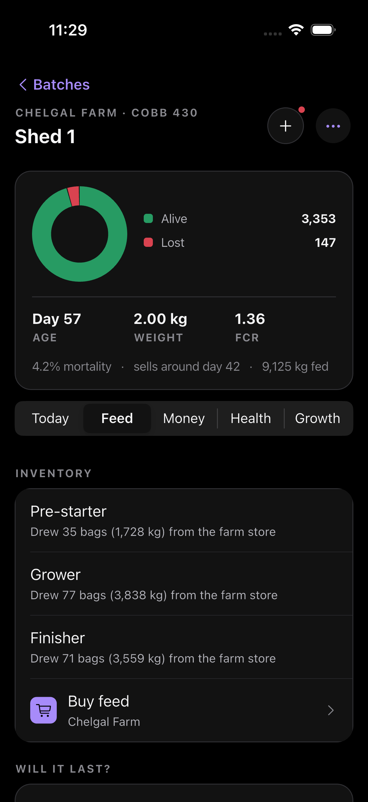
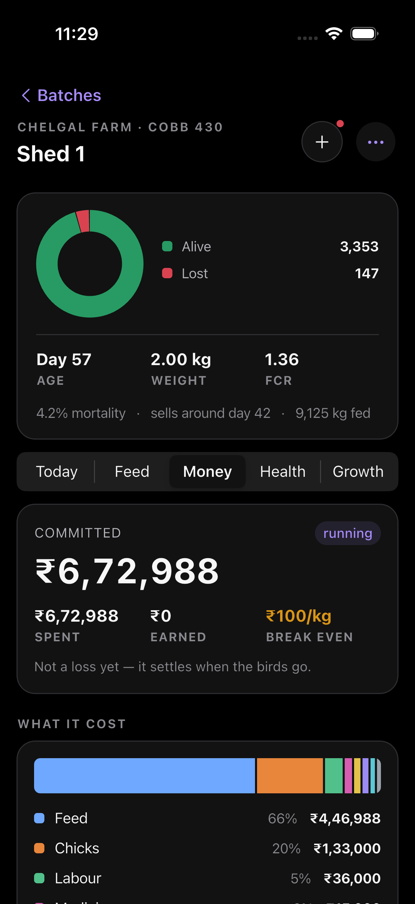
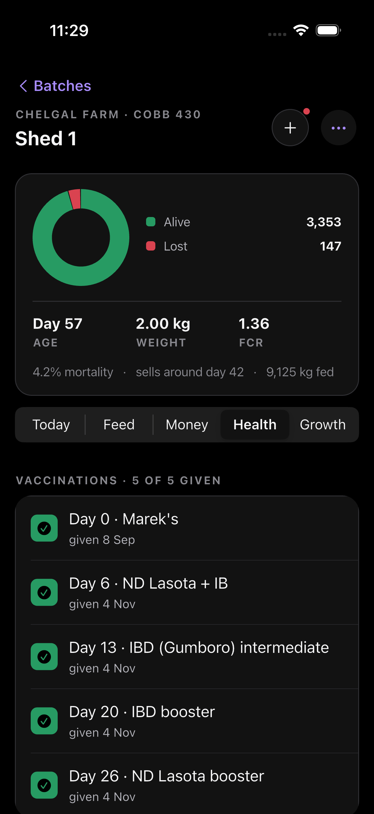
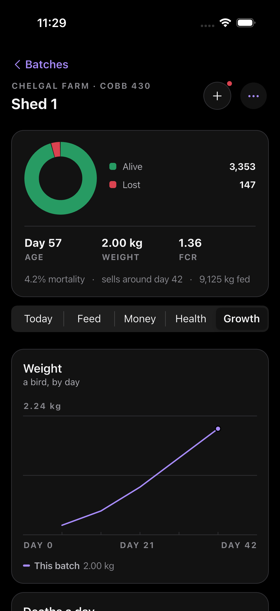
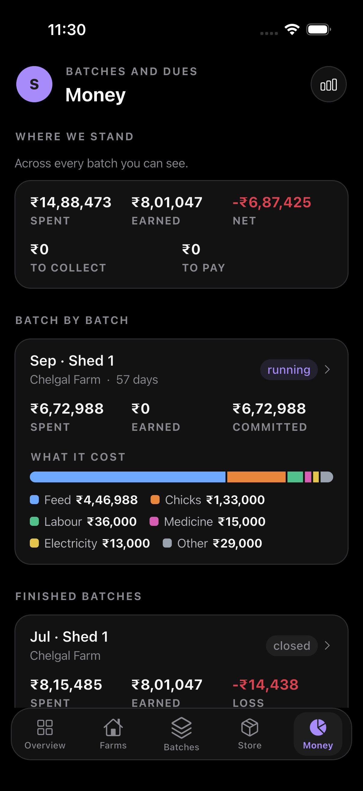
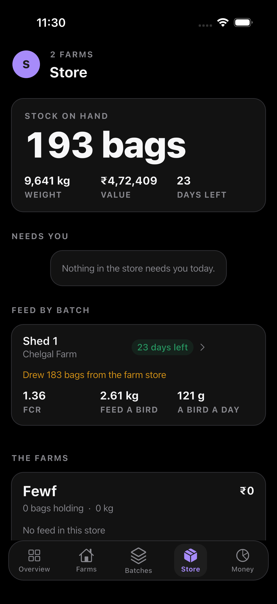
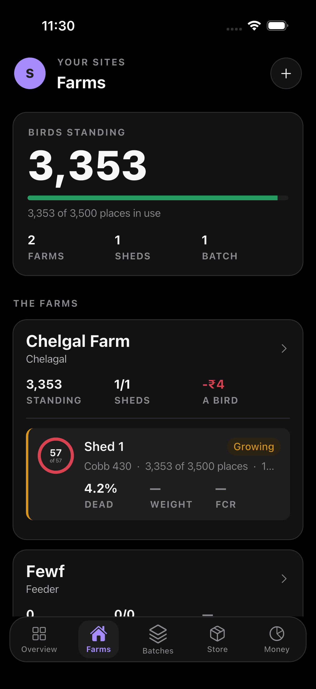

# 18 · Farmer App UI Specification

Status: written 4 November 2026, from the source of `kukkuone-farmer-mobile` at
commit `c0f1ac2` plus one uncommitted change that trims the batch hero and
three explanatory notes. Every token, component and screen below was read out
of the code, not designed on paper — where the code and this document disagree,
the code is right and this document is stale.

Audience: a reviewer, human or agent, evaluating the interface. §11 draws every
screen — the ten that carry the product from the running app, with screenshots,
and the rest from the source. §10 says what to evaluate and §9 lists the
deviations already known, so a review that only rediscovers §9 has found
nothing new.

Companion documents: `.claude/skills/mobile-ui-quality/SKILL.md` is the
enforceable rulebook this app is held to; `15-Batch-Centric-Redesign.md` is
why the batch hub is shaped the way it is.

---

## 1. What the product is, in one screen

A farmer runs sheds of broiler chickens in batches of three to five thousand
birds, for 40–50 days each. The app is how a batch is recorded and judged: how
many are alive, what they weigh, what they have eaten, what it has cost, and
whether anything is going wrong. Half of its users read Telugu, most of them
read it outdoors in direct sunlight, and many are tapping with dusty or gloved
hands at arm's length while standing in a shed.

Those three facts — **Telugu, sunlight, gloves** — are the reason behind most
of the rules below, and are the right lens for any review.

---

## 2. Foundations

### 2.1 Two palettes, two moods

The app runs **two complete design languages**, and a screen belongs to one of
them, never to both.

| | **night** | **canvas** |
|---|---|---|
| Namespace | `N.*` colour, `NT.*` type | `C.*` colour, `T.*` type |
| Scaffold | `NightScreen` | `CanvasScreen`, `SheetScreen` |
| Feel | dark ground, big figures, a bloom behind the header | iOS inset-grouped lists, quieter |
| Used for | list and summary screens: Overview, Batches, Money, Farms, Store | detail and form screens: a batch, a shed, a form |
| Source | `lib/core/design/night.dart` | `lib/core/design/tokens.dart` |

Both resolve through one active theme, so **light mode is a real mode**. Every
colour is a *getter*, never a `const`, because a baked constant keeps whichever
palette was in force when the widget was first built.

> **Rule.** A literal `Color(0xFF…)` in a feature file is a defect. It renders
> correctly in whichever mode its author had open and is unreadable in the
> other. `test/theme_test.dart` enforces this two ways: every drawing token is
> sampled in both palettes and must differ, and no `Color(0x…)` may appear in
> `lib/features` or `lib/widgets` at all.

### 2.2 Colour tokens

Semantic names only. Every one carries a single meaning, and **never carries it
alone** — a status colour always ships with a word or a glyph, because roughly
8% of men have a colour vision deficiency and a red dot on its own says nothing
to them.

**night — dark (default)**

| Token | Hex | Meaning |
|---|---|---|
| `N.bg` | `#000000` | the ground |
| `N.surface` | `#121212` | a card |
| `N.surfaceHi` | `#1E1E1E` | a pressed or raised card |
| `N.line` | `#2F2F33` | hairline |
| `N.ink` | `#F7F7F8` | primary text |
| `N.ink2` | `#B5B5BC` | secondary text |
| `N.ink3` | `#89898F` | tertiary text, figure captions |
| `N.accent` | `#A78BFA` | brand, links, the one primary action |
| `N.accentPressed` | `#7C3AED` | its pressed state |
| `N.onAccent` | `#1E1E1E` | text on an accent fill |
| `N.good` | `#279B63` | healthy, done, paid |
| `N.warn` | `#D99516` | due, attention, break-even |
| `N.bad` | `#D94350` | dead, overdue, loss |
| `N.data2` | `#287FC1` | a second data series |

**night — light**

| Token | Hex |
|---|---|
| `N.bg` | `#F8F7FA` |
| `N.surface` | `#FFFFFF` |
| `N.surfaceHi` | `#FFFFFF` |
| `N.line` | `#E9E4F0` |
| `N.ink` / `ink2` / `ink3` | `#241E30` / `#6F687B` / `#938CA1` |
| `N.accent` / `accentPressed` / `onAccent` | `#7C3AED` / `#6D28D9` / `#FFFFFF` |
| `N.good` / `warn` / `bad` / `data2` | `#279B63` / `#9A6A00` / `#D94350` / `#287FC1` |

`warn` darkens from `#D99516` to `#9A6A00` in light mode — amber on white fails
contrast at the lighter value. `good` and `bad` are deliberately identical
across themes: they are the two colours a farmer learns, and moving them would
teach the app twice.

The canvas layer (`C.*`) is a semantic alias over the same palette —
`C.tint → N.accent`, `C.ok → N.good`, `C.due → N.warn`, `C.bad → N.bad`,
`C.label/label2/label3 → N.ink/ink2/ink3`, `C.card → N.surface`,
`C.separator → N.line`. There is **one** source of colour.

### 2.3 Type

Two scales, one per palette. Nothing is below 13pt on the canvas scale and
nothing below 12pt on the night scale — this is read in sunlight.

**night (`NT.*`)** — the display scale, deliberately heavier than its paper
equivalent because light text on a dark ground optically thins.

| Token | Size / weight | Tracking | For |
|---|---|---|---|
| `NT.mega` | 52 / w800 | −2.2 | the one number a screen is about |
| `NT.big` | 29 / w700 | −1.0 | a card's headline figure |
| `NT.title` | 21 / w700 | −0.5 | a card or screen title |
| `NT.name` | 16 / w600 | −0.2 | a row's name |
| `NT.body` | 14.5 / w400 | — | running text |
| `NT.quiet` | 13.5 / w400 | — | secondary text (`N.ink2`) |
| `NT.label` | 12 / w700 | **+1.4** | ALL-CAPS figure captions (`N.ink3`) |

`NT.mega`, `NT.big` and every `T.number*` style carry
`FontFeature.tabularFigures()`, so digits do not jitter in a column.

`NT.label` is 12, not 10.5. It captions every figure in the app — ALIVE,
WEIGHT, FCR, DIED — and at 10.5 grey on black it disappeared in daylight.

**canvas (`T.*`)** — Apple's SF scale, names matching Apple's so the intent is
unambiguous: `largeTitle` 34/w700 · `title1` 28 · `title2` 22 · `title3` 20 ·
`headline` 17/w600 · `body` 17/w400 · `callout` 16 · `subhead` 15 ·
`footnote` 13 · `caption` 13/w500. Figures: `numberXL` 34/w700,
`numberL` 24/w700, `number` 17/w600, all tabular.

### 2.4 Space, shape, targets

An **8-pt grid**, with 4 where 8 is too loose.

| | Values |
|---|---|
| Spacing (`DS.s*`) | 2, 4, 6, 8, 12, 16, 20, 24, 32, 40 |
| Night rhythm | `N.gutter` 16, `N.gap` 12, `N.block` 26 |
| Side gutter | **16** on every screen, both palettes |
| Radii (canvas) | `rCard` 10, `rControl` 8, `rSheet` 12, `rPill` 100 |
| Radii (night) | `N.r` 18, `N.rSmall` 10 |
| Hit target | `DS.tapMin` **44** minimum; `DS.rowHeight` **52** for list rows |

Rows are 52, not 44: Apple's minimum assumes a bare fingertip, and this is
tapped with gloves on.

> **The gutter contract.** `CanvasScreen` pads its children; `NightScreen` and
> `SheetScreen` do not. A shared component therefore asks
> `Guttered.inset(context)` before adding its own margin, or it lands 32pt in
> while the card below it sits at 16. The batch screen shipped exactly that
> bug — hero and segment control at 32, cards at 16 —
> and `test/alignment_test.dart` now measures the edges of nine screens.

### 2.5 Motion

Tokens only: `DS.fast` 180ms, `DS.normal` 260ms, `DS.slow` 420ms, easing
`Curves.easeOutCubic` in and `easeInCubic` out. A screen may not invent its own
237ms.

The contract that matters:

- **Reduced motion means no motion.** `Entrance` puts no animation widget in
  the tree at all and `context.motion(d)` returns `Duration.zero`. A shortened
  animation is still an animation; for a vestibular disorder "faster" is not
  what was asked for.
- Therefore **everything animated is a reveal of something already legible
  without it.** Motion is never the only way a value appears.
- Opacity and transform only. Animating width, height or padding makes every
  frame a layout pass.
- One or two moving things per screen. A stagger caps at six
  (`context.stagger`); past that it stops being a flourish and becomes a
  loading screen.
- iOS does not ripple, it dims and shrinks slightly: `Pressable` is the one
  press behaviour, `NoSplash` is set globally.

---

## 3. Components

All in `lib/core/design/`. A screen composes these; it does not draw its own.

### 3.1 Scaffolds (page templates)

| Component | Anatomy | Pads children? |
|---|---|---|
| `NightScreen` | dark ground, ambient bloom behind the header, eyebrow + title, optional leading/trailing, pull-to-refresh | **no** |
| `CanvasScreen` | canvas ground, back line, title, circle buttons at top right | **yes** |
| `SheetScreen` | a form as a page of its own; **draws its own Cancel**; commit action in the bar | **no** |
| `NavScreen` | large title collapsing to a centred title on scroll | — |

A screen uses one of these when one fits. Three do not and carry their own
chrome on a `CupertinoPageScaffold`: the auth front door, the case photo and
the sale slip. That is a decision to justify in a comment, not a defect.

`SheetScreen` rules: do not add a second Cancel; a picker inside it closes with
`closeForm`, **never** a bare `Navigator.pop` — popping the sheet's own
navigator leaves an invisible sheet swallowing every tap on the screen beneath.

### 3.2 Surfaces

| Component | What it is |
|---|---|
| `Raised` | a card on the canvas with light under it — a black shadow below, a lit top edge on the surface itself |
| `Tile` | the night equivalent |
| `Field` | the gradient field, one per screen, carrying the subject |
| `CanvasSection` | a headed group of rows as a raised card |
| `Section` | a titled group of rows, hairlines inset from the left |
| `Heading` | a quiet canvas heading (not a grouped-list header) |
| `SectionHeader` | a standalone group heading |

### 3.3 Rows and controls

| Component | Notes |
|---|---|
| `Cell` | leading glyph, title, optional subtitle, value or chevron on the right. **The title takes the space and the trailing takes its own width**, capped so a long Telugu label ellipsizes — equal flex on both split the row in half and floated every count mid-row |
| `Pressable` | the one press behaviour; bare text inside it measures only the text, so wrap it to reach 44 |
| `PrimaryButton` | the single filled action on a screen |
| `SecondaryButton` | tinted text on a soft fill |
| `CardAction` | a thumb-sized button sitting on a card rather than in a bar |
| `CircleButton` / `BackCircle` / `BackLine` | canvas header controls |
| `StatusPill` | a state in **a word and a colour**, never a colour alone |
| `QuickBar` / `QuickAction` | a row of shortcuts: glyph, word, and a count when the number is the point |
| `Segments` | a segmented control, two or three mutually exclusive choices |
| `Chips` | wrapping selectable chips for a short flat option set |

### 3.4 Fields

`HeroNumberField` (the one number a screen is about — thumb-sized, centred,
autofocused), `NumberCell`, `TextCell`, `PickerCell`, `SwitchCell`.

### 3.5 Figures

| Component | Contract |
|---|---|
| `Figures([...])` | a row of figures. **Three at most — it asserts**, and `theme_test` catches a hand-built `Row` of `Expanded(child: Fig(…))` that would never reach the assert |
| `Fig(value, label)` | one figure and its ALL-CAPS name |
| `Stat` | one number and what it is — the unit of every dashboard here |
| `BigFigure` | an unboxed number that is the point of its card |
| `TrendStat` / `FigureWithTrend` | a figure with its recent shape beside it |
| `ComputedValue` | a label and a figure on one line, outside a `Section` |
| `ProgressRing` | how far through its cycle a batch is, drawn rather than written |
| `AttentionRow` | one thing needing attention, on one line |

### 3.6 Charts

Charts live in **two** places, which is itself worth a reviewer's attention:
`core/design/plots.dart` holds `Plot`, `ComparePlot`, `RunTimeline`,
`RankBars`, `StackBar`, `DayStackBars`, `AgeingBars`, `Donut` and `Measures`;
`lib/widgets/charts.dart` holds `TrendLine` and a second `Donut` (the night one
is the one in use, and `batch_detail_screen.dart` imports the other with
`hide Donut` to say so).

Chart rules, each earned from a shipped defect:

- **One series, one chart.** The Feed segment drew kg/day and bags/day from the
  same logs; keep one and put the other unit in the readout.
- **Never put quantities of different magnitude on one scale when the small one
  is the point.** Costs-by-category stacked beside income turned every cost bar
  into a sliver. Give each its own chart on a shared day axis.
- **A scrolling chart never clips its first or last axis label.**
- A reference line (e.g. the breed standard) is drawn **dashed**, not as a
  second series — it is not a measurement of this batch and must not read as
  one.
- `Donut` sizes its ring to `min(size, width × 0.42)` so the legend always wins
  the space. The ring totals the birds placed; the segments are where each one
  is now — alive, sold, lost. Nothing in the hole.

### 3.7 States

`Skeleton` (shimmerless — a spinner says nothing, a shape says what is coming),
`Empty`, `Failed` (what went wrong and one way out), `InlineError` (said once,
where the thing went wrong).

- Design **loading, empty, sparse, dense and error** for every screen, and say
  which of "nothing yet" and "nothing matches" an empty state means.
- **No dead ends.** An empty state that cannot be acted on from where it stands
  is a cul-de-sac.
- **Never a button that does nothing.** A lifecycle stage that declared itself
  drivable with no branch to run rendered a primary button that silently fell
  through. This shipped.

---

## 4. Content rules

These are as much a part of the interface as the pixels.

**Localisation.** Every user-facing string lives in `lib/l10n/app_en.arb` and
`app_te.arb`, at exact parity, enforced by `telugu_test`. Telugu runs
materially longer than English and is the single largest source of shipped
overflow. Therefore: every `Text` inside a `Row` is in an `Expanded` or
`Flexible` with `maxLines` and `TextOverflow.ellipsis`; commit labels and nav
actions are **one or two words** ("Send", not "Send to partner" — who it goes
to is the subtitle's job); and an `options[]` **key** is never translated, only
its label, because a translated key falls through its own switch silently.

**Money.** Paise end to end, divided only where printed: `money(paise / 100)`.
**Indian digit grouping** — `₹1,71,500`, never `₹171,500`. Never
`toStringAsFixed` into a currency string. An **amount** takes `money()`, which
rounds to whole rupees; a **unit rate** takes `rate()`, which keeps its paise
and groups the same way. Exports and PDFs are held to this too — they outlive
the screen that produced them.

**Figures.** Null is `—`, never `0`: a figure with no data and a figure that is
genuinely zero are different facts, and showing a bill as `₹0` before it exists
is the worse of the two errors. A figure and its unit never break apart — join
with ` `.

**One number, one computation.** A farm's feed rate and days left once came out
as 6 days on the farm screen and 23 on the Store tab from the same stock. Every
screen that states a derived figure calls the same function. A corollary this
app treats as a layout rule: *what is already printed elsewhere on the screen
is not a second finding.*

---

## 5. Screen inventory

62 screen classes. Scaffold in brackets: **N**ight, **C**anvas, **S**heet,
**V** = NavScreen.

| Area | Screens |
|---|---|
| auth | SignIn *(`CupertinoPageScaffold` — no house scaffold fits an auth screen; see §9.7)* |
| onboarding | AccountSetup **V**, FarmSetup **V** |
| overview | Overview **N**, Attention **N** |
| dashboard | Dashboard **N** |
| batches | Batches **N**, **BatchDetail C**, PlaceBatch **S**, PlaceChicks **S**, CloseBatch **S**, CorrectPlacementDate **S** |
| farms | Farms **N**, FarmDetail **C**, ShedDetail **C**, FarmForm **S**, ShedForm **S** |
| logs | DailyLog **S**, WeightSample **S**, LogDetail **C** |
| health | MedicineStock **C**, AddMedication **S**, MedicinePurchase **S** |
| vet | VetCases **N**, VetCase **N**, AskVet **S** |
| harvest | Offer **S** |
| money | Money **N**, Accounts **N**, AccountStatement **N**, Costs **N**, Reports **N**, Expenses **C**, FeedStock **C**, Allocation **C**, SellBirds **S**, RecordPayment **S**, SupplierPayment **S**, FeedPurchase **S**, AddExpense **S**, AccountEntry **S**, AccountForm **S**, AccountTransfer **S**, PartyForm **S**, Wages **S** |
| inventory | Inventory **N**, StoreLedger **N**, SellFeed **S** |
| insight | Alerts **C**, AlertSettings **C**, History **C**, Standards **C**, StandardForm **S** |
| partner | PartnerOrders **N**, OrderDetail **N**, OrderChicks **S**, OrderFeed **S** |
| more | Account **N**, Profile **N**, Settings **N**, People **V**, InviteMember **S** |

Five tabs: Overview · Farms · Batches · Store · Money. Every screen above is
drawn in §11.

---

## 6. The batch hub — the screen the product turns on

`BatchDetailScreen` (canvas). A batch is a shed full of birds from placement to
close, and **everything a batch owns lives here**, in one header, one hero and
five segments.

```
┌─────────────────────────────────────────┐
│ ‹ Batches                               │  back line
│ CHELGAL FARM · COBB 430          (+) (⋯)│  eyebrow + circle actions
│ Shed 1                                  │  title
├─────────────────────────────────────────┤
│  ╭───╮   ● Alive            3,353       │  HERO (Tile)
│  │ ◯ │   ● Lost               147       │  Donut, ring = birds placed,
│  ╰───╯                                  │  segments = alive / sold / lost
│  ─────────────────────────────────────  │
│  Day 57      2.00 kg      1.36          │  Figures(3)  — the assert
│  AGE         WEIGHT       FCR           │  NT.label captions
│  4.2% mortality · sells around day 42 · │  a fourth..sixth value as a
│  9,125 kg fed                           │  sentence, never a 4th Fig
├─────────────────────────────────────────┤
│ [ Today | Feed | Money | Health |Growth]│  Segments
└─────────────────────────────────────────┘
```

| Segment | Carries |
|---|---|
| **Today** | stage timeline (`Stage 2 of 5`, name, primary action, "All five stages"), quick actions (Log today / Mortality / Feed used), the batch arc, the facts table, every logged day newest first with gaps shown as gaps |
| **Feed** | inventory, issued to this batch, "will it last" (kg/day, g/bird/day, days of cover), feed added, bags-a-day chart |
| **Money** | committed or profit headline with a `running`/`closed` pill, spent / earned / break-even, cost breakdown by category, costs by day, lots sold, costs, pending to collect and to pay |
| **Health** | withdrawal banner (the one thing that can stop a sale), vaccination checklist against days, medication courses, medicine inventory, add medication, ask a vet |
| **Growth** | weight against the breed standard (dashed reference), deaths a day, weigh a sample |

Design decisions worth a reviewer's attention:

- The hero repeats on all five segments. That is deliberate — the question
  "how many are alive" outranks whichever tab you are on — but it is also the
  largest single block of vertical space in the app.
- The quick actions appear **only while birds are in the shed**. A closed batch
  once still offered Log today and Mortality, which write a day against a run
  that ended.
- A log row's date turns red on a heavy-mortality day; the count is **not**
  printed twice in two colours.
- Daily-log subtitles show whole kilos. A run of days reading
  "426.6 · 416.2 · 405.8" against a 50 kg bag is noise beside the day and the
  deaths; the entered figure is a tap away in the day's own record.

---

## 7. Accessibility and field conditions

| Constraint | What it forces |
|---|---|
| Sunlight | nothing below 12pt; `NT.label` raised from 10.5 to 12; amber darkened in light mode |
| Gloves | 52pt rows, 44pt absolute minimum |
| Colour vision | a status colour never travels alone — always a word or a glyph |
| Vestibular | reduced motion means **no** motion, and nothing appears only by animating |
| Telugu | every row flexes; labels are one or two words; ARB parity is a test |
| 320pt phones | `screens_test` mounts each screen at 320×568 in **both** locales, where an overflow is a framework exception rather than a farmer's complaint |

---

## 8. What enforces this

| Test | Enforces |
|---|---|
| `screens_test` | all 62 screens mount at 320×568 in English and Telugu, in light and dark, with a 3:1 contrast floor and a check that no skeleton is still showing |
| `alignment_test` | nine screens' cards share the 16pt gutter |
| `telugu_test` | en/te ARB parity |
| `no_hardcoded_strings_test` | user-facing English in the source |
| `motion_test` | reduced motion is honoured |
| `nav_bar_test`, `cell_test`, `batch_ring_test`, `money_figures_test`, … | component contracts |

993 tests pass at the commit this document describes.

---

## 9. Known deviations

Found by audit on 4 November 2026. Listed so a review can look past them.
9.1 to 9.6 were fixed the same day and 9.7 was mostly withdrawn; 9.8 to 9.10 are open.

**9.1 — FIXED 4 November. Nine figure labels were English on a Telugu phone.**
`Fig`'s label is its *second* argument, and `no_hardcoded_strings_test` only
inspected `Heading(` and `Text(`, only matched a **capitalised** first letter,
and only single quotes. Figure captions are upper-cased on screen by
`NT.label`, so they are naturally written lower-case in source — precisely the
shape the lint could not see. The audit first counted seven; a scan that reads
multi-line calls found nine.

| File | Label | Now reads |
|---|---|---|
| `money_screen.dart:477,479,482` | `'owed'`, `'past terms'`, `'buyers'` | `figOwed`, `figPastTerms`*, `figBuyers`* |
| `money_screen.dart:542,543` | `'owing'`, `'suppliers'` | `figOwing`, `figSuppliers`* |
| `reports_screen.dart:380,385` | `'a bird'`, `'margin'` | `figABird`, `trajectoryMargin` |
| `reports_screen.dart:392,393` | `'sold'`, `'batches'` | `figSold`, `figBatches` |

Six of the nine already had a key with a Telugu translation and were simply
not using it. Three were new (*), and their Telugu follows constructions the
ARB already carries — `కొనుగోలుదారులు` is the plural `figOwedByBuyers` already
uses, and `బ్యాచ్‌లు` is how `figBatches` pluralises.

**The lint gap was the real defect**, so a sixth test now reads the label
*position* rather than the shape of the words, and cares about neither case
nor quote nor interpolation: the second argument of a `Fig`, the first of a
`Heading` or `SectionHeader`, and any `label:`, `header:` or `caption:`. It
ignores a literal carrying no word outside an interpolation (`' · '`,
`'${n} '`) and it leaves `options[]` keys alone, which must never be
translated. Verified by reintroducing `'owed'` and watching it fail with the
right file and line.

**9.2 — FIXED 4 November. Loose English inside interpolations.**
`overview_charts.dart:386` read `label: 'of $target'` on the Overview ring and
now reads `ovOfTarget`, whose Telugu `{target}లో` matches the construction
`lifecycleStageOf` already uses. `supplier_payment_screen.dart:219` built
`'{n} day/days · {n}-day terms'` with the plural chosen by a ternary, and now
composes `dayCount` and `creditDaysTerms`, both of which already existed.

Still open: `'${…} days'` in `close_batch_screen.dart:138` and
`sell_birds_screen.dart:391`. Both are inside `Text(`, not a label argument,
so the new lint does not reach them; the prose ratchet already counts them.

**9.3 — FIXED 4 November. Eleven screens were never mounted by
`screens_test`.** `Accounts`, `AccountEntry`, `AccountForm`,
`AccountStatement`, `AccountTransfer`, `Attention`, `Offer`, `Reports`,
`SellFeed`, `StandardForm` and `StoreLedger` had never been rendered at
320×568, in Telugu, or in light mode. All 62 screen classes are in the sweep
now; the suite went from 912 tests to 990.

Two real defects came out on the first run, which is the argument for the rule:

- **`StandardFormScreen` left Cupertino's own placeholder grey**, `#c5c5c7` —
  **1.73:1** on a white card and **2.43:1** on a dark one, against the sweep's
  3:1 floor. The hint saying whether a box wants grams or an FCR was the least
  readable text on the screen. It takes `C.label3` now, as the sign-in number
  field already did.
- **`StoreLedgerScreen` overflowed by 3.5pt in Telugu at 320pt.** The balance
  at the end of each ledger row was a bare `Text` in a `Row` and could not give
  way. A static sweep for that rule had reported the screen clean, because the
  row *does* contain an `Expanded` — just not around the text that needed one.
  Only mounting it in Telugu found it.

One thing the work exposed about the harness rather than the app:
`storeLedgerProvider` awaits three providers the harness overrides and then
calls `StockRepo.issues` directly, which in a test never answers. The screen
sat on its skeleton, and without the sweep's own "a screen still showing a
skeleton has not been checked" assertion the audit would have passed against a
blank page. The override now hands it the same pure `storeLedger()` the app
runs, over fixtures already in the harness, so the arithmetic stays under test.

**9.4 — FIXED 4 November. Currency built by hand, without Indian grouping.**
The audit found five sites; there were **eight**. Seven screens built a unit
rate as `'₹${x.toStringAsFixed(2)}'`, so a five-figure feed rate read
`₹100000.00` beside a total reading `₹1,00,000`.

`money()` could not stand in for them: it rounds to whole rupees, and ₹36.50 a
chick is not ₹37 a chick — on 3,500 birds the difference is ₹1,750. So
`formatters.dart` gains `rate()`, grouped the same way and keeping its paise,
with a test for the distinction between the two.

The eighth site is the one that matters most and was not on the UI at all:
`export_service.dart:22` built its own `'₹672988'` for the **settlement PDF**,
a sheet that sits in somebody's downloads folder for a year reading
differently from every screen it was printed from.

Two further defects sat on the same lines. Sell birds printed a lot's weight
with `toStringAsFixed(0)`, so a 9,125 kg lot read "9125 kg" against an amount
grouped as ₹9,12,500. And the feed purchase title chose `'bag'` or `'bags'`
with a ternary, in English — which `bagsCount` already exists for, and which
the existing ternary lint missed because it looks for a capital letter. That
is the same blind spot §9.1 closed for label arguments; it is still open for
ternaries.

**9.5 — FIXED 4 November. Chart colours baked into feature files.** Ten
literal colours sat outside `core/design/`: six as `ChartColors.categorical`
in `widgets/charts.dart`, picked for a white surface back when the app was
light-only, and six in `overview/dashboard_charts.dart` picked for the dark
one. Neither moved when the palette did.

Neither needed to exist. `plots.dart` already carries `seriesTones` — two
validator-checked sets, one per ground, switched by the theme, with a note
explaining why light mode gets its own steps rather than a computed shade of
the dark ones. Both call sites read it now, so the app's two chart layers
agree on hue as well as on ink.

**The gap that let them sit there is the more useful finding.** `theme_test`
already had a test called "no drawing token is frozen to one palette", and it
sampled `ChartColors`' four inks and `seriesTones` — but not the slots in
between, which is exactly where the frozen six lived. The slots are sampled
now; putting the `const` back makes it fail and names all six. A second test
states the rule itself, since sampling named tokens can never find a literal
in a file nobody thought to sample: no `Color(0x…)` in `lib/features` or
`lib/widgets`, fully transparent excepted, because "draw nothing" is not a
colour choice.

**9.6 — FIXED 4 November. Bare `Row` of `Fig`.** The audit found three; there
were **five**, across Money, Reports and Accounts. `Figures([...])` asserts a
row holds at most three, and a hand-built `Row(children: [Expanded(child:
Fig(...))])` renders identically while never reaching the assert — so none of
the five was ever counted.

One of them carried four. On the closed-batches card it was *a bird · margin ·
sold · batches*, and `batches` qualifies none of the other three: it is the
**scope** of the figure above them. It reads as the sentence it always was
now, through `acrossFinishedBatches`, which already existed with its Telugu.

**The gap: an assert only fires on the component nobody used.** A test now
reads the shape instead — a `Row` whose children are `Expanded(child: Fig(…))`
is the thing `Figures` exists for. It walks to the line that closes the `Row`
at the same indent rather than a fixed window, which would otherwise read into
the next widget and call a legitimate `Figures()` below a `Row` a bare one.

Fixed in passing: the shed row in `overview_charts.dart` had an `Expanded`
`Text` and a bare one beside it — the shape that overflowed the store ledger
in Telugu at 320pt (§9.3). It fits today; it is `Flexible` now anyway, because
the rule is a MUST and not a reaction.

**9.7 — PARTLY WITHDRAWN, and fixed where it was right. 4 November.**
The finding said the first screen every user meets should move onto a house
scaffold. Checked properly, that was wrong: **none of the four fits an auth
screen.** There is no title to collapse, nothing behind it to go back to, and
`SheetScreen` would draw a Cancel that must not be there. The screen was
already canvas end to end — `C`, `T` and `DS` throughout, `CircleButton`,
`PrimaryButton`, `SecondaryButton` and `InlineError` — with not one raw colour
or spacing value in 535 lines. The single numeric literal is `96 * 0.224`, the
iOS icon corner radius, documented where it sits.

What *was* true underneath it: the screen imported
`package:flutter/material.dart` to get one name, `Scaffold`, and used it for
nothing but the box — no `Theme`, no `ScaffoldMessenger`, no `SnackBar`. It
was the only Material scaffold in the app. It is `CupertinoPageScaffold` now,
which is what the two other pages that carry their own chrome rather than a
house scaffold already use: the case photo and the sale slip.

**The corrected rule**, for whoever reads §3.1 next: a screen uses a house
scaffold when one fits. Three do not — the auth front door and the two
full-screen viewers — and those use `CupertinoPageScaffold` directly. A
screen building its own chrome is a decision to justify in a comment, not a
defect by itself.

**9.8 — No breed standard for Cobb 430.** The Growth segment's dashed reference
line is the point of the chart and does not draw, because no `BreedStandard`
row matches the seeded breed. This is a reference-data gap, not a layout one,
and per the project's own rule a threshold no vet has confirmed must be marked
`TODO(vet): confirm` rather than invented.

**9.9 — Density, not correctness.** The hero occupies roughly 240pt on all five
segments, and the Today segment's stage card spends about 290pt on a progress
bar, "Stage 2 of 5", a stage name, a caption that repeats the three buttons
directly beneath it, a full-width button and a disclosure link. "Mark ready for
harvest" is also a four-word commit label against a one-or-two-word rule.

**9.10 — The same batch, two different answers.** On the Farms tab the Shed 1
row prints `—` for WEIGHT and FCR while the batch's own screen, the Batches
card and the Store tab all print 2.00 kg and 1.36 for it at the same moment.
Seen on the running app, 4 November. The cause is most likely the farms
summary payload not carrying those two fields, so the UI correctly renders
"no data" — but a farmer reading two screens sees the app contradict itself,
which is what "one number, one computation" exists to prevent. Worth tracing
from `farms_screen.dart` back to the endpoint before deciding where to fix it.

---

## 10. What to evaluate

A review is most useful on the things a test cannot assert:

1. **Does the hero earn its space on all five segments**, or should the lower
   four collapse it to a single line?
2. **Is the stage card worth 290pt**, and does its caption survive sitting
   directly above the three buttons that say the same thing?
3. **Is five segments the right cut of a batch**, or is Growth really part of
   Today?
4. **Does the night/canvas split read as one product**, or as two apps — the
   batch hub is canvas and the list it was opened from is night.
5. **Does every status colour genuinely travel with a word**, screen by screen.
6. **Telugu at 320pt** beyond what a mount test can see. 9.3 closed the
   coverage gap and the overflow it found, but a row that fits by 1pt and a
   row that reads badly look identical to the sweep.
7. **Light mode**, which is far less exercised than dark — the deviations in
   9.5 are visible there and nowhere else.
8. **Does any screen show a figure a second time** in a different shape? That
   is this codebase's most repeated defect and the fastest thing to find.
9. **Does any screen show a figure the app knows as `—`?** §9.10 is one
   instance found by eye in a few minutes; a sweep across the five tabs
   against one batch would say whether it is the only one.

---

## 11. Screen frames

Every screen in the app, drawn. Frames are 402×874 points (iPhone 17 Pro), the
size `alignment_test` measures at; `screens_test` additionally mounts each one
at **320×568**, which is the width to design against.

**How to read a frame.** The box is the phone. Indentation is nesting. A name
in `Code` is the house component that draws the block, and “quoted” text is the
real English string from `app_en.arb` — the Telugu is longer, always. The
**States** line under each frame lists the loading, empty and error treatments
that screen actually implements; a screen with no States line implements none,
which is itself a finding.

§11.1 is drawn by hand from the running app and the source. §11.2 is derived
from the source directly: it shows a repeated row once, because the row is
built in a loop, and it stops at 24 blocks.

---

### 11.1 The screens the product turns on

#### Overview — `NightScreen` · the first tab



```
┌──────────────────────────────────────────────────────────┐
│ (s)  EVERYTHING YOU RUN                            (🔔•) │  avatar · eyebrow · alerts
│      Overview                                            │  the dot marks unread
│                                                          │
│ LIVE BIRDS                                               │  SectionHeader
│ ╭──────────────────────────────────────────────────────╮ │
│ │   ╭────╮       ● Alive                     3,353     │ │  Donut — ring totals the
│ │   │ ◯  │       ● Lost                        147     │ │  birds placed
│ │   ╰────╯                                             │ │
│ │  ────────────────────────────────────────────────────│ │
│ │   3,500 placed across 1 batch                        │ │  NT.quiet, the anchor
│ ╰──────────────────────────────────────────────────────╯ │
│ MORTALITY                                                │
│ ╭──────────────────────────────────────────────────────╮ │
│ │ 4.7%                                                 │ │  axis top
│ │                                        ●             │ │  ComparePlot — one line
│ │                              ╱                       │ │  per shed, % by day
│ │        ╱                                             │ │
│ │ DAY 0          DAY 30          DAY 60                │ │  first and last labels
│ │ ▬ Shed 1  4.2%                                       │ │  never clipped
│ ╰──────────────────────────────────────────────────────╯ │
│ WEIGHT                                                   │  the same shape again
│ ╭──────────────────────────────────────────────────────╮ │
│ │ ComparePlot against the breed standard               │ │
│ ╰──────────────────────────────────────────────────────╯ │
│ [Overview] Farms  Batches  Store  Money                  │  tab bar, 5 tabs
└──────────────────────────────────────────────────────────┘
```
States: `Skeleton` · `Failed` · `Empty` “No farms yet”

#### Batches — `NightScreen` · the list a batch is opened from



```
┌──────────────────────────────────────────────────────────┐
│ (s)  YOUR RUN                                        (+) │
│      Batches                                             │
│                                                          │
│ RUNNING                                                  │  SectionHeader
│ ╭──────────────────────────────────────────────────────╮ │  BatchBoardCard
│ │ ╭───╮  Shed 1                                        │ │  ProgressRing: day 57,
│ │ │57 │  Chelgal Farm · Cobb 430                       │ │  “15 over”, ring turns
│ │ │15 │  ( Growing )                                   │ │  red past target
│ │ ╰───╯                                   StatusPill   │ │
│ │ ████████████████████████████████████████████░        │ │  alive vs placed
│ │ ■ Alive                              96%    3,353    │ │
│ │ □ Lost                                4%      147    │ │
│ │                                                      │ │
│ │ MORTALITY        FEED A BIRD                         │ │  2×2 figure grid,
│ │ 4.2%     ╲__     2.6 kg      ╱                       │ │  each with its trend
│ │ FCR              AVG WEIGHT                          │ │
│ │ 1.36             2.00 kg                             │ │
│ │                                                      │ │
│ │ [ Log today ] [ Mortality ] [ Feed used ]            │ │  QuickBar, 3 actions
│ ╰──────────────────────────────────────────────────────╯ │
│                                                          │
│ FINISHED                                                 │
│ ╭──────────────────────────────────────────────────────╮ │
│ │ Shed 1                                      10 Jul   │ │
│ │ Chelgal Farm · ran 45 days                           │ │
│ │ PROFIT A BIRD     FCR        MORTALITY               │ │  Figures(3)
│ │ -₹4               1.47       4.9%                    │ │
│ ╰──────────────────────────────────────────────────────╯ │
│ Overview  Farms  [Batches]  Store  Money                 │
└──────────────────────────────────────────────────────────┘
```
States: `Skeleton` · `Failed` · `Empty` “No batches yet”

#### The batch hub — `CanvasScreen` · header and hero, shared by all five segments

```
┌──────────────────────────────────────────────────────────┐
│ ‹ Batches                                                │  BackLine
│ CHELGAL FARM · COBB 430                      ( + ) ( ⋯ ) │  eyebrow · CircleButtons
│ Shed 1                                                   │  title (the shed code)
│                                                          │
│ ╭─ Tile ───────────────────────────────────────────────╮ │  THE HERO
│ │   ╭────╮      ● Alive                      3,353     │ │  Donut, ring = 104pt
│ │   │ ◯  │      ● Lost                         147     │ │  ring total = placed;
│ │   ╰────╯      (● Sold, when any)                     │ │  segments = where each
│ │  ────────────────────────────────────────────────────│ │  bird is now
│ │   Day 57        2.00 kg        1.36                  │ │  Figures(3) — asserts 3
│ │   AGE           WEIGHT         FCR                   │ │  NT.label captions
│ │   4.2% mortality · sells around day 42 · 9,125 kg fed│ │  values 4–6 as a sentence,
│ ╰──────────────────────────────────────────────────────╯ │  never a fourth Fig
│                                                          │
│ [ Today | Feed | Money | Health | Growth ]                │  Segments
│                                                          │
│ … the selected segment renders below …                   │
└──────────────────────────────────────────────────────────┘
```
States: `Skeleton` (whole screen) · `Failed` with retry
Preparing variant: the hero collapses to “Preparing shed” + chicks due.

#### Batch › Today



```
┌──────────────────────────────────────────────────────────┐
│ WHERE THIS BATCH IS                                      │  Heading
│ ╭──────────────────────────────────────────────────────╮ │  StageTimeline
│ │ ███████ ███████ ░░░░░░ ░░░░░░ ░░░░░░                 │ │  5 stage bars
│ │ Stage 2 of 5                                         │ │  NT.label
│ │ Growing                                              │ │  NT.title
│ │ Log the day — feed, deaths, weight.                  │ │  stage caption
│ │ [         Mark ready for harvest          ]          │ │  PrimaryButton
│ │ All five stages ⌄                                    │ │  disclosure
│ ╰──────────────────────────────────────────────────────╯ │
│ [ Log today ] [ Mortality ] [ Feed used ]                │  QuickBar — only while
│                                                          │  birds are in the shed
│ WHAT HAS HAPPENED                                        │
│ ╭──────────────────────────────────────────────────────╮ │
│ │ BatchArc — the batch's whole life on one line:       │ │
│ │ placement, vaccinations, courses, sales, today       │ │
│ ╰──────────────────────────────────────────────────────╯ │
│ BATCH                                                    │
│ ╭──────────────────────────────────────────────────────╮ │
│ │ Placed                                     8 Sep     │ │  label left, value right,
│ │ Placed birds                                3,500    │ │  value ellipsizes
│ │ Died                                          147    │ │
│ │ Culled                                          0    │ │
│ │ Breed                                   Cobb 430     │ │
│ │ Hatchery                                     …       │ │
│ ╰──────────────────────────────────────────────────────╯ │
│ DAILY LOGS                                               │  CanvasSection
│ ╭──────────────────────────────────────────────────────╮ │
│ │ ⊖ 2 days not logged                                  │ │  the gap is the finding
│ │ Day 57 · 4 Nov                                    ›  │ │  date turns red on a
│ │ 3 died · 426 kg feed · 2.00 kg a bird · Ravi         │ │  heavy day; the count is
│ │ Day 56 · 3 Nov                                    ›  │ │  not printed twice
│ ╰──────────────────────────────────────────────────────╯ │
└──────────────────────────────────────────────────────────┘
```
States: `Skeleton` (logs) · `Failed` · `Empty` “Nothing logged yet”

#### Batch › Feed



```
┌──────────────────────────────────────────────────────────┐
│ INVENTORY                                                │  CanvasSection
│ ╭──────────────────────────────────────────────────────╮ │
│ │ Pre-starter                                          │ │  one row per feed type
│ │ Drew 35 bags (1,728 kg) from the farm store          │ │  bags AND kg, because
│ │ Grower                                               │ │  the store counts bags
│ │ Drew 77 bags (3,838 kg) from the farm store          │ │  and the log counts kg
│ │ Finisher                                             │ │
│ │ Drew 71 bags (3,559 kg) from the farm store          │ │
│ │ ▣ Buy feed                            Chelgal Farm › │ │  the action, in place
│ ╰──────────────────────────────────────────────────────╯ │
│ WILL IT LAST?                                            │  Heading
│ ╭──────────────────────────────────────────────────────╮ │
│ │  … kg         … g          …                         │ │  Figures(3) — the three
│ │  A DAY        A BIRD/DAY   FEED DAYS                 │ │  that answer the heading
│ │  The whole farm's store, not this shed's.            │ │  one line, scoping it
│ ╰──────────────────────────────────────────────────────╯ │
│ ╭─ ChartCard “Bags a day” ─────────────────────────────╮ │
│ │ Plot — one series only. kg a day lives in the        │ │  the segment once drew
│ │ readout, not as a second line on the same axes.      │ │  kg/day and bags/day
│ ╰──────────────────────────────────────────────────────╯ │  from the same logs
│ ISSUED TO THIS BATCH · BOUGHT FOR THIS BATCH             │  two more CanvasSections
└──────────────────────────────────────────────────────────┘
```
States: `Skeleton` · `Failed` · `Cell` “Nothing issued yet” with
“The feed figures come from the daily logs.”
Worth checking: the Store tab states 23 days left for this batch — confirm
FEED DAYS here agrees, since the two once disagreed (6 against 23).

#### Batch › Money



```
┌──────────────────────────────────────────────────────────┐
│ ╭──────────────────────────────────────────────────────╮ │
│ │ COMMITTED                                 ( running )│ │  label + StatusPill
│ │ ₹6,72,988                                            │ │  NT.mega, tabular
│ │ ₹6,72,988      ₹0            ₹100/kg                 │ │  Figures — SPENT,
│ │ SPENT          EARNED        BREAK EVEN              │ │  EARNED, BREAK EVEN
│ │ Not a loss yet — it settles when the birds go.       │ │  one line, not a para
│ ╰──────────────────────────────────────────────────────╯ │
│ WHAT IT COST                                             │
│ ╭──────────────────────────────────────────────────────╮ │
│ │ ████████████████████ ███████ ██ ▌▌▌▌                 │ │  StackBar
│ │ ● Feed                        66%        ₹4,46,988   │ │
│ │ ● Chicks                      20%        ₹1,33,000   │ │
│ │ ● Labour                       5%          ₹36,000   │ │
│ ╰──────────────────────────────────────────────────────╯ │
│ DAY BY DAY                                               │
│ ╭──────────────────────────────────────────────────────╮ │
│ │ COSTS BY DAY · D29–D36                     ₹21,413   │ │  DayStackBars — costs
│ │ ▌▌▌▌▌▌▌▌                                             │ │  and income get their
│ │ D29 D30 D31 D32 D33 D34 D35 D36                      │ │  own charts on one
│ ╰──────────────────────────────────────────────────────╯ │  shared day axis
│ ₹49,000 of shared farm costs has no single day.          │  one-line note
│ LOTS SOLD                                                │
│ ╭──────────────────────────────────────────────────────╮ │
│ │ No birds lifted yet                                  │ │
│ │ Lots appear here as traders take them.               │ │
│ ╰──────────────────────────────────────────────────────╯ │
│ COSTS · TO COLLECT · TO PAY                              │  three CanvasSections
└──────────────────────────────────────────────────────────┘
```
States: `Skeleton` ×3 · `Failed` ×3 · empties inside each section
Closed variant: COMMITTED becomes PROFIT or LOSS, the pill becomes `closed`.

#### Batch › Health



```
┌──────────────────────────────────────────────────────────┐
│ ╭──────────────────────────────────────────────────────╮ │  the withdrawal banner
│ │ ⚠ Withdrawal running                                 │ │  outranks everything:
│ │   Safe to sell from 12 Nov                           │ │  it stops a lorry
│ ╰──────────────────────────────────────────────────────╯ │  tinted 10% bad/ok
│ VACCINATIONS · 5 OF 5 GIVEN                              │  header counts
│ ╭──────────────────────────────────────────────────────╮ │
│ │ ☑ Day 0 · Marek's                                    │ │  a checklist against
│ │   given 8 Sep                                        │ │  days, not a diary
│ │ ☑ Day 6 · ND Lasota + IB                             │ │
│ │   given 4 Nov                                        │ │
│ │ ☑ Day 13 · IBD (Gumboro) intermediate                │ │
│ ╰──────────────────────────────────────────────────────╯ │
│ MEDICATION                                               │  hidden when empty —
│ ╭──────────────────────────────────────────────────────╮ │  "nothing given" above
│ │ Course · what, when, withdrawal                      │ │  "nothing bought" was
│ ╰──────────────────────────────────────────────────────╯ │  two cards saying nothing
│ MEDICINE INVENTORY                                       │
│ ╭──────────────────────────────────────────────────────╮ │
│ │ ▣ Buy medicine                        Chelgal Farm › │ │
│ ╰──────────────────────────────────────────────────────╯ │
│ ╭──────────────────────────────────────────────────────╮ │
│ │ ▣ Add medication                                  ›  │ │
│ │ ▣ Ask a vet                                       ›  │ │  carries the batch id
│ ╰──────────────────────────────────────────────────────╯ │
└──────────────────────────────────────────────────────────┘
```
States: `Skeleton` ×2 · `Failed` ×2 · `Cell` “No schedule on this batch”

#### Batch › Growth



```
┌──────────────────────────────────────────────────────────┐
│ ╭─ ChartCard “Weight” ─────────────────────────────────╮ │
│ │ a bird, by day   ← caption, replaced by the verdict  │ │  “8% ahead” / “12% behind”
│ │ 2.24 kg                                              │ │  toned good/warn/bad
│ │        ╱                                             │ │
│ │     ╱     ┄┄┄┄ breed standard, DASHED                │ │  a reference line, never
│ │  ╱                                                   │ │  a second series
│ │ DAY 0        DAY 21        DAY 42                    │ │  first and last labels
│ │ ▬ This batch  2.00 kg                                │ │  are never clipped
│ ╰──────────────────────────────────────────────────────╯ │
│ ╭─ ChartCard “Deaths a day” ───────────────────────────╮ │
│ │ last 14 logged days                                  │ │
│ │ TrendLine — the shape matters more than any day      │ │
│ ╰──────────────────────────────────────────────────────╯ │
│ ╭──────────────────────────────────────────────────────╮ │
│ │ ◉ Weigh a sample                                  ›  │ │  no dead end: the empty
│ ╰──────────────────────────────────────────────────────╯ │  state is actionable here
└──────────────────────────────────────────────────────────┘
```
States: `Empty` “Not enough to draw yet” until 2 weights or 3 loss days
Known gap: the dashed standard does not draw for Cobb 430 — see §9.8.

#### Money — `NightScreen` · the fifth tab



```
┌──────────────────────────────────────────────────────────┐
│ (s)  BATCHES AND DUES                              (▮▮▮) │  CircleButton → Reports
│      Money                                               │
│                                                          │
│ WHERE WE STAND                                           │  Heading
│ Across every batch you can see.                          │  scope, said once
│ ╭──────────────────────────────────────────────────────╮ │
│ │ ₹14,88,473    ₹8,01,047    -₹6,87,425                │ │  Figures(3), NET toned
│ │ SPENT         EARNED       NET                       │ │  bad when negative
│ │ ₹0            ₹0                                     │ │  values 4–5 as a second
│ │ TO COLLECT    TO PAY                                 │ │  row, never a 4th Fig
│ ╰──────────────────────────────────────────────────────╯ │
│ BATCH BY BATCH                                           │
│ ╭──────────────────────────────────────────────────────╮ │
│ │ Sep · Shed 1                        ( running )  ›   │ │  month · shed, StatusPill
│ │ Chelgal Farm · 57 days                               │ │
│ │ ₹6,72,988     ₹0           ₹6,72,988                 │ │  Figures(3)
│ │ SPENT         EARNED       COMMITTED                 │ │
│ │ WHAT IT COST                                         │ │
│ │ ████████████████ ███████ ██ ▌▌▌                      │ │  StackBar
│ │ ● Feed    ₹4,46,988   ● Chicks  ₹1,33,000            │ │  two-column legend,
│ │ ● Labour    ₹36,000   ● Medicine  ₹15,000            │ │  amount beside the name
│ ╰──────────────────────────────────────────────────────╯ │
│ FINISHED BATCHES                                         │
│ ╭──────────────────────────────────────────────────────╮ │
│ │ Jul · Shed 1                        ( closed )   ›   │ │
│ │ ₹8,15,485     ₹8,01,047    -₹14,438                  │ │  COMMITTED becomes
│ │ SPENT         EARNED       LOSS                      │ │  PROFIT or LOSS
│ ╰──────────────────────────────────────────────────────╯ │
│ … further down: to collect, to pay, AgeingBars, parties  │  ⚠ five English Fig
│ Overview  Farms  Batches  Store  [Money]                 │    labels live here —
└──────────────────────────────────────────────────────────┘    §9.1, and §9.6
```
States: `Skeleton` ×4 · `Failed` ×4

#### Store — `NightScreen` · the fourth tab



```
┌──────────────────────────────────────────────────────────┐
│ (s)  2 FARMS                                             │  eyebrow counts the farms
│      Store                                               │
│ ╭──────────────────────────────────────────────────────╮ │
│ │ STOCK ON HAND                                        │ │  NT.label
│ │ 193 bags                                             │ │  NT.mega — the one
│ │ 9,641 kg      ₹4,72,409    23                        │ │  number this screen is
│ │ WEIGHT        VALUE        DAYS LEFT                 │ │  about, then Figures(3)
│ ╰──────────────────────────────────────────────────────╯ │
│ NEEDS YOU                                                │
│    ╭────────────────────────────────────────────╮        │  a pill, not a card:
│    │ Nothing in the store needs you today.      │        │  the quiet state is
│    ╰────────────────────────────────────────────╯        │  visibly lighter
│ FEED BY BATCH                                            │
│ ╭──────────────────────────────────────────────────────╮ │
│ │ Shed 1                          ( 23 days left )  ›  │ │  StatusPill, toned by
│ │ Chelgal Farm                                         │ │  how little is left
│ │ Drew 183 bags from the farm store                    │ │  amber — the link back
│ │ 1.36          2.61 kg      121 g                     │ │  to the farm's stock
│ │ FCR           FEED A BIRD  A BIRD A DAY              │ │  Figures(3)
│ ╰──────────────────────────────────────────────────────╯ │
│ THE FARMS                                                │
│ ╭──────────────────────────────────────────────────────╮ │
│ │ Fewf                                          ₹0     │ │  one card per farm store
│ │ 0 bags holding · 0 kg                                │ │
│ │ No feed in this store                                │ │  empty, in place
│ ╰──────────────────────────────────────────────────────╯ │
│ Overview  Farms  Batches  [Store]  Money                 │
└──────────────────────────────────────────────────────────┘
```
States: `Skeleton` · `Empty` “No farms yet”

#### Farms — `NightScreen` · the second tab



```
┌──────────────────────────────────────────────────────────┐
│ (s)  YOUR SITES                                      (+) │
│      Farms                                               │
│ ╭──────────────────────────────────────────────────────╮ │
│ │ BIRDS STANDING                                       │ │
│ │ 3,353                                                │ │  NT.mega
│ │ ████████████████████████████████████████████░        │ │  places in use
│ │ 3,353 of 3,500 places in use                         │ │
│ │ 2             1            1                         │ │  Figures(3)
│ │ FARMS         SHEDS        BATCH                     │ │
│ ╰──────────────────────────────────────────────────────╯ │
│ THE FARMS                                                │
│ ╭──────────────────────────────────────────────────────╮ │
│ │ Chelgal Farm                                      ›  │ │  name, then village
│ │ Chelagal                                             │ │
│ │ 3,353         1/1          -₹4                       │ │  Figures(3)
│ │ STANDING      SHEDS        A BIRD                    │ │
│ │ ────────────────────────────────────────────────────  │ │
│ │ ▌ ╭───╮  Shed 1                    ( Growing )       │ │  a nested shed row,
│ │ ▌ │57 │  Cobb 430 · 3,353 of 3,500 places · 1…       │ │  subtitle ellipsizes
│ │ ▌ ╰───╯  4.2%        —           —                   │ │  ⚠ WEIGHT and FCR are
│ │ ▌        DEAD        WEIGHT      FCR                 │ │    dashes here and
│ ╰──────────────────────────────────────────────────────╯ │    2.00 kg / 1.36 on the
│ ╭──────────────────────────────────────────────────────╮ │    batch itself — §9.10
│ │ Fewf                                              ›  │ │
│ │ Feeder                                               │ │
│ ╰──────────────────────────────────────────────────────╯ │
│ Overview  [Farms]  Batches  Store  Money                 │
└──────────────────────────────────────────────────────────┘
```
States: `Skeleton` · `Failed` · `Empty` “No farms yet”

---

### 11.2 Every other screen, from the source

Derived mechanically from `lib/features`, so a row built in a loop appears
once and a frame stops at 24 blocks. Labels are the real `app_en.arb` strings;
`<name>` is a placeholder the string interpolates.

#### Sign in

**sign_in_screen.dart** — `Scaffold`
```
┌─ sign_in_screen ─────────────────────────────────────────┐
│ PrimaryButton                                            │
│   SecondaryButton “Sign in”                              │
└──────────────────────────────────────────────────────────┘
```
States: InlineError


#### The batch

**close_batch_screen.dart** — `SheetScreen` · “Close batch”
```
┌─ Close batch ────────────────────────────────────────────┐
│     Section “How it ended”                               │
│     Cell “Placed”                                        │
│     Cell “Died”                                          │
│     Cell “Culled”                                        │
│     Cell “Sold”                                          │
│     Cell “Age at close”                                  │
│     PickerCell “Closing on”                              │
│     Section “<n> still in the shed”                      │
│     Cell                                                 │
│     Section “Notes”                                      │
│     TextCell “Note”                                      │
│ Section “Feed and medicine”                              │
│   Cell “Nothing bought for this batch yet”               │
└──────────────────────────────────────────────────────────┘
```
States: InlineError

**correct_placement_date_screen.dart** — `SheetScreen` · “Correct the date”
```
┌─ Correct the date ───────────────────────────────────────┐
│ Section “The placement”                                  │
│     Cell “Recorded as”                                   │
│     PickerCell “Placed on”                               │
│     Cell “Age”                                           │
└──────────────────────────────────────────────────────────┘
```
States: InlineError

**place_batch_screen.dart** — `SheetScreen`
```
┌─ place_batch_screen ─────────────────────────────────────┐
│ Segments                                                 │
│   HeroNumberField                                        │
│ Section “The placement”                                  │
│     PickerCell                                           │
│     TextCell “Breed”                                     │
│     PickerCell “Hatchery”                                │
│   Section “Chick cost”                                   │
│     NumberCell “Rate”                                    │
│     NumberCell “Discount”                                │
│     Cell                                                 │
│     SwitchCell “Paid”                                    │
│   Segments                                               │
└──────────────────────────────────────────────────────────┘
```
States: InlineError

**place_chicks_screen.dart** — `SheetScreen` · “Chicks arrived”
```
┌─ Chicks arrived ─────────────────────────────────────────┐
│ HeroNumberField                                          │
│ Section “The placement”                                  │
│     PickerCell “Placed on”                               │
│     TextCell “Breed”                                     │
│     PickerCell “Hatchery”                                │
│ Section “Chick cost”                                     │
│     NumberCell “Rate”                                    │
│     NumberCell “Discount”                                │
│     Cell                                                 │
│     SwitchCell “Paid”                                    │
│ Segments                                                 │
└──────────────────────────────────────────────────────────┘
```
States: InlineError

**stage_timeline.dart** — `SheetScreen` · “Mark ready for harvest”
```
┌─ Mark ready for harvest ─────────────────────────────────┐
│ StageTimeline                                            │
│   CanvasSection “Where this batch is”                    │
│     PrimaryButton                                        │
│     NumberCell “Birds lifted”                            │
│     NumberCell “Total weight (kg)”                       │
└──────────────────────────────────────────────────────────┘
```


#### Dashboard

**dashboard_screen.dart** — `NightScreen`
```
┌─ dashboard_screen ───────────────────────────────────────┐
│     Tile                                                 │
│     Tile                                                 │
│     Tile                                                 │
│     Tile                                                 │
│     Tile                                                 │
│ Tile                                                     │
└──────────────────────────────────────────────────────────┘
```
States: Failed · Skeleton


#### Farms and sheds

**farm_detail_screen.dart** — `CanvasScreen` · “Farm”
```
┌─ Farm ───────────────────────────────────────────────────┐
│     BigFigure “birds here”                               │
│     BigFigure “sheds full”                               │
│     Heading “The farm”                                   │
│     Raised                                               │
│     Heading “Sheds”                                      │
│     Heading “What it has earned”                         │
│     Raised                                               │
│     BigFigure                                            │
│     BigFigure                                            │
│     BigFigure                                            │
│ Raised                                                   │
└──────────────────────────────────────────────────────────┘
```
States: Empty “Gone” · Empty “No sheds yet” · Failed · Skeleton

**farm_form_screen.dart** — `SheetScreen` · “Add a farm”
```
┌─ Add a farm ─────────────────────────────────────────────┐
│ Section                                                  │
│     TextCell “Name”                                      │
│     TextCell “Village”                                   │
│ Segments                                                 │
│     Section                                              │
│     TextCell “Lessor”                                    │
│     NumberCell “Rent”                                    │
│     PickerCell “Charged”                                 │
└──────────────────────────────────────────────────────────┘
```
States: InlineError

**shed_detail_screen.dart** — `CanvasScreen`
```
┌─ shed_detail_screen ─────────────────────────────────────┐
│     BigFigure                                            │
│     BigFigure                                            │
│     BigFigure                                            │
│     Heading “In the shed now”                            │
│     Heading “Mortality, batch by batch”                  │
│     Raised                                               │
│     TrendLine                                            │
│     Heading “Batches before this”                        │
│     Raised                                               │
│   Raised                                                 │
│     StatusPill                                           │
│     BigFigure                                            │
│     BigFigure                                            │
│     BigFigure                                            │
│ Raised                                                   │
│     PrimaryButton                                        │
└──────────────────────────────────────────────────────────┘
```
States: Failed · Skeleton

**shed_form_screen.dart** — `SheetScreen` · “Add a shed”
```
┌─ Add a shed ─────────────────────────────────────────────┐
│ Section                                                  │
│     TextCell “Name”                                      │
│     NumberCell “Capacity”                                │
│ Segments                                                 │
│   SecondaryButton                                        │
└──────────────────────────────────────────────────────────┘
```
States: InlineError


#### Harvest

**offer_screen.dart** — `SheetScreen` · “Offer harvest”
```
┌─ Offer harvest ──────────────────────────────────────────┐
│ Section “The lot”                                        │
│     NumberCell “Birds offered”                           │
│     NumberCell “Average weight”                          │
│     PickerCell “Ready on”                                │
│     NumberCell “Asking rate”                             │
│ Section “Who sees this”                                  │
│ Section “Notes”                                          │
│     TextCell “Notes”                                     │
└──────────────────────────────────────────────────────────┘
```
States: InlineError


#### Medicine

**add_medication_screen.dart** — `SheetScreen` · “Add medication”
```
┌─ Add medication ─────────────────────────────────────────┐
│ Section “What was given”                                 │
│     PickerCell “Product”                                 │
│     NumberCell “Quantity”                                │
│ Segments                                                 │
│ Section “The course”                                     │
│     PickerCell “Started”                                 │
│     PickerCell “Ended”                                   │
│     NumberCell “Withdrawal”                              │
│ Section “Cost”                                           │
│     Cell “From the store at <rate> per <unit>”           │
│     NumberCell “Cost”                                    │
│     TextCell “Note”                                      │
└──────────────────────────────────────────────────────────┘
```
States: InlineError

**medicine_purchase_screen.dart** — `SheetScreen` · “Medicine purchase”
```
┌─ Medicine purchase ──────────────────────────────────────┐
│ Section “What was bought”                                │
│     PickerCell “Product”                                 │
│     NumberCell “Quantity”                                │
│     NumberCell “Rate”                                    │
│     Cell                                                 │
│ Section “The bill”                                       │
│     PickerCell “Supplier”                                │
│     PickerCell “Expires”                                 │
│     TextCell “Invoice”                                   │
│     PickerCell “Date”                                    │
│     SwitchCell “Paid”                                    │
└──────────────────────────────────────────────────────────┘
```
States: InlineError

**medicine_stock_screen.dart** — `CanvasScreen` · “Medicine”
```
┌─ Medicine ───────────────────────────────────────────────┐
│     CanvasSection “Worth a look”                         │
│     Cell                                                 │
│   CanvasSection “On the shelf”                           │
│     Cell “Name”                                          │
│ Section “What is on the shelf”                           │
│     NumberCell “Name”                                    │
│ Section                                                  │
│     TextCell “Reason”                                    │
└──────────────────────────────────────────────────────────┘
```
States: Empty “The store is empty” · Failed · InlineError · Skeleton


#### Insight

**alert_settings_screen.dart** — `CanvasScreen` · “Alerts”
```
┌─ Alerts ─────────────────────────────────────────────────┐
│   CanvasSection “What fires”                             │
│ SwitchCell                                               │
│     NumberCell                                           │
└──────────────────────────────────────────────────────────┘
```
States: Failed · Skeleton

**alerts_screen.dart** — `CanvasScreen` · “Alerts”
```
┌─ Alerts ─────────────────────────────────────────────────┐
│     CanvasSection “Today”                                │
│     CanvasSection “Earlier”                              │
│ Cell                                                     │
└──────────────────────────────────────────────────────────┘
```
States: Empty “Nothing needs attention” · Failed · Skeleton

**history_screen.dart** — `CanvasScreen` · “History”
```
┌─ History ────────────────────────────────────────────────┐
│     CanvasSection                                        │
│ Cell                                                     │
└──────────────────────────────────────────────────────────┘
```
States: Empty “Nothing recorded yet” · Failed · Skeleton

**standards_screen.dart** — `CanvasScreen` · “Breed standards”
```
┌─ Breed standards ────────────────────────────────────────┐
│     CanvasSection                                        │
│     Cell “<n> points · day <from>–<to>”                  │
│ Section                                                  │
│     TextCell “Breed”                                     │
│     Cell “Breed”                                         │
│ Section “Standard by day”                                │
└──────────────────────────────────────────────────────────┘
```
States: Empty “No standards yet” · Failed · InlineError · Skeleton


#### Store

**sell_feed_screen.dart** — `SheetScreen` · “Sell feed”
```
┌─ Sell feed ──────────────────────────────────────────────┐
│ HeroNumberField                                          │
│   PickerCell “Feed”                                      │
│ NumberCell “Bags”                                        │
│   PickerCell “Buyer”                                     │
│ SwitchCell “Paid now”                                    │
│     PickerCell                                           │
│     PickerCell                                           │
└──────────────────────────────────────────────────────────┘
```


**store_ledger_screen.dart** — `NightScreen` · “Store ledger”
```
┌─ Store ledger ───────────────────────────────────────────┐
│     Tile                                                 │
│ Tile                                                     │
│     Figures                                              │
│     Fig “…”                                              │
│     Fig “…”                                              │
│     Fig                                                  │
│     Fig                                                  │
│ Tile                                                     │
└──────────────────────────────────────────────────────────┘
```
States: Empty “Nothing has moved through this store yet” · Failed · Skeleton


#### Daily records

**daily_log_screen.dart** — `SheetScreen`
```
┌─ daily_log_screen ───────────────────────────────────────┐
│     StatusPill “Late entry”                              │
│   HeroNumberField                                        │
│     Chips                                                │
│ Section “The day”                                        │
│     NumberCell “Culls”                                   │
│     NumberCell “Water”                                   │
│     NumberCell “Temperature”                             │
│     PickerCell “Date”                                    │
│   Section                                                │
│     NumberCell “Culls”                                   │
│     PickerCell “Date”                                    │
│ Segments                                                 │
│ Section                                                  │
│     NumberCell “Bags”                                    │
│     NumberCell “Loose”                                   │
│     Cell “Fed today”                                     │
│ Section “Note”                                           │
│     TextCell “Observation”                               │
└──────────────────────────────────────────────────────────┘
```
States: InlineError

**log_detail_screen.dart** — `CanvasScreen`
```
┌─ log_detail_screen ──────────────────────────────────────┐
│ Figures                                                  │
│   Fig                                                    │
│   Fig                                                    │
│   Fig                                                    │
│ CanvasSection “Daily log”                                │
│     Cell “Alive”                                         │
│     Cell “Feed”                                          │
│     Cell “Water”                                         │
│     Cell “Temperature”                                   │
│     Cell “Humidity”                                      │
│     Cell “The sample”                                    │
│     Cell “Note”                                          │
│ CanvasSection                                            │
│     Cell “History”                                       │
└──────────────────────────────────────────────────────────┘
```


**weight_sample_screen.dart** — `SheetScreen` · “Weigh a sample”
```
┌─ Weigh a sample ─────────────────────────────────────────┐
│ Section “The sample”                                     │
│     NumberCell “Birds weighed”                           │
│     NumberCell “Together they weigh”                     │
└──────────────────────────────────────────────────────────┘
```
States: InlineError


#### Money

**account_entry_screen.dart** — `SheetScreen` · “Accounts”
```
┌─ Accounts ───────────────────────────────────────────────┐
│ HeroNumberField                                          │
│   PickerCell “Accounts”                                  │
│ TextCell “Notes”                                         │
│     PickerCell                                           │
└──────────────────────────────────────────────────────────┘
```


**account_form_screen.dart** — `SheetScreen` · “New account”
```
┌─ New account ────────────────────────────────────────────┐
│ TextCell “Account name”                                  │
│   PickerCell “Type”                                      │
│   PickerCell “Sits under”                                │
│ NumberCell “Opening balance”                             │
│     PickerCell                                           │
└──────────────────────────────────────────────────────────┘
```


**account_statement_screen.dart** — `NightScreen`
```
┌─ account_statement_screen ───────────────────────────────┐
│     Tile                                                 │
│     Tile                                                 │
│     Tile                                                 │
│ Tile                                                     │
└──────────────────────────────────────────────────────────┘
```
States: Failed · Skeleton

**account_transfer_screen.dart** — `SheetScreen` · “Transfer”
```
┌─ Transfer ───────────────────────────────────────────────┐
│ HeroNumberField                                          │
│ PickerCell “From”                                        │
│ PickerCell “To”                                          │
│ TextCell “Notes”                                         │
│     PickerCell                                           │
└──────────────────────────────────────────────────────────┘
```


**accounts_screen.dart** — `NightScreen` · “In hand”
```
┌─ In hand ────────────────────────────────────────────────┐
│   Tile                                                   │
│     Fig                                                  │
│     Fig                                                  │
│     Fig                                                  │
│ Tile                                                     │
│ Tile                                                     │
└──────────────────────────────────────────────────────────┘
```
States: Failed · Skeleton

**allocation_screen.dart** — `CanvasScreen` · “<head> split”
```
┌─ <head> split ───────────────────────────────────────────┐
│     SecondaryButton                                      │
│     PrimaryButton “Save split”                           │
│     SecondaryButton                                      │
│     PrimaryButton “Recalculate”                          │
│ CanvasSection                                            │
│     Cell “Cost”                                          │
│     Cell “Month”                                         │
│     Cell “Split”                                         │
│ CanvasSection “Shares”                                   │
│     Cell “No batch was alive that month”                 │
│     NumberCell                                           │
│     Cell                                                 │
└──────────────────────────────────────────────────────────┘
```
States: InlineError

**costs_screen.dart** — `NightScreen` · “Costs”
```
┌─ Costs ──────────────────────────────────────────────────┐
│   QuickBar                                               │
│   Tile                                                   │
│     RankBars                                             │
│     Tile                                                 │
│ Tile                                                     │
└──────────────────────────────────────────────────────────┘
```
States: Empty “Nothing entered yet” · Failed · Skeleton

**expenses_screen.dart** — `CanvasScreen` · “Costs”
```
┌─ Costs ──────────────────────────────────────────────────┐
│     CanvasSection                                        │
│     Cell                                                 │
│     StatusPill “On credit”                               │
│   Segments                                               │
│ HeroNumberField                                          │
│ Chips                                                    │
│ Section “Details”                                        │
│     PickerCell                                           │
│     SwitchCell “Paid”                                    │
│     PickerCell “Owed to”                                 │
│     TextCell “Note”                                      │
└──────────────────────────────────────────────────────────┘
```
States: Empty “No farm costs yet” · Failed · InlineError · Skeleton

**feed_purchase_screen.dart** — `SheetScreen` · “Feed purchase”
```
┌─ Feed purchase ──────────────────────────────────────────┐
│ Chips                                                    │
│ Section “Quantity”                                       │
│     NumberCell “Bag size”                                │
│     NumberCell “Bags”                                    │
│     NumberCell “Loose”                                   │
│ Segments                                                 │
│ Section                                                  │
│     NumberCell “Rate”                                    │
│     NumberCell “Discount”                                │
│     Cell                                                 │
│ Section “The bill”                                       │
│     PickerCell “Supplier”                                │
│     TextCell “Invoice”                                   │
│     PickerCell “Date”                                    │
│     SwitchCell “Paid”                                    │
└──────────────────────────────────────────────────────────┘
```
States: InlineError

**feed_stock_screen.dart** — `CanvasScreen` · “Feed”
```
┌─ Feed ───────────────────────────────────────────────────┐
│     CanvasSection “Worth a look”                         │
│     Cell                                                 │
│     Cell                                                 │
│   CanvasSection “In the store”                           │
│     Cell                                                 │
│ Section “Bags on hand”                                   │
│     NumberCell                                           │
│ Section                                                  │
│     TextCell “Reason”                                    │
└──────────────────────────────────────────────────────────┘
```
States: Empty “The store is empty” · Failed · InlineError · Skeleton

**party_form_screen.dart** — `SheetScreen` · “New <kind>”
```
┌─ New <kind> ─────────────────────────────────────────────┐
│ Section “Name”                                           │
│     TextCell “Name”                                      │
│     TextCell “Phone”                                     │
│     TextCell “Place”                                     │
│   Section “Usual rate”                                   │
│     NumberCell “Declared”                                │
│     NumberCell “Discount”                                │
│   Section “Credit”                                       │
│     NumberCell “Terms”                                   │
└──────────────────────────────────────────────────────────┘
```
States: InlineError

**record_payment_screen.dart** — `SheetScreen`
```
┌─ record_payment_screen ──────────────────────────────────┐
│ HeroNumberField                                          │
│ Segments                                                 │
│ Section “Reference”                                      │
│     TextCell “Reference”                                 │
│     PickerCell “Date”                                    │
│     PrimaryButton                                        │
└──────────────────────────────────────────────────────────┘
```
States: InlineError

**reports_screen.dart** — `NightScreen` · “Reports”
```
┌─ Reports ────────────────────────────────────────────────┐
│     Tile                                                 │
│     Tile                                                 │
│     Tile                                                 │
│     Fig                                                  │
│     Fig                                                  │
│     Fig                                                  │
│     Tile                                                 │
│     StackBar “Received”                                  │
│   Tile                                                   │
│ Tile                                                     │
│     Tile                                                 │
│   Tile                                                   │
│     Fig                                                  │
│     Fig                                                  │
│     Fig                                                  │
│     Fig                                                  │
│     Tile                                                 │
└──────────────────────────────────────────────────────────┘
```
States: Failed · Skeleton

**sell_birds_screen.dart** — `SheetScreen` · “Sell birds”
```
┌─ Sell birds ─────────────────────────────────────────────┐
│ Section “<n> birds remaining”                            │
│     PickerCell “Buyer”                                   │
│     PickerCell “Lifted by”                               │
│     PickerCell “Through”                                 │
│     PickerCell “Lifted on”                               │
│     Cell “Credit terms”                                  │
│ Section “The lot”                                        │
│     NumberCell “Birds lifted”                            │
│     NumberCell “Gross weight”                            │
│     TextCell “Vehicle”                                   │
│     PickerCell “Weighment slip”                          │
│ Section “Rate”                                           │
│     NumberCell “Market rate”                             │
│     NumberCell “Discount”                                │
│     Cell                                                 │
└──────────────────────────────────────────────────────────┘
```
States: InlineError

**supplier_payment_screen.dart** — `SheetScreen`
```
┌─ supplier_payment_screen ────────────────────────────────┐
│ HeroNumberField                                          │
│ Segments                                                 │
│ Section “Reference”                                      │
│     TextCell “Reference”                                 │
│     PickerCell “Date”                                    │
│     PrimaryButton                                        │
└──────────────────────────────────────────────────────────┘
```
States: InlineError

**wages_screen.dart** — `SheetScreen` · “Wages”
```
┌─ Wages ──────────────────────────────────────────────────┐
│ Segments                                                 │
│   Section “Who worked”                                   │
│     NumberCell “People”                                  │
│     NumberCell “Days worked”                             │
│     NumberCell “A day, each”                             │
│   HeroNumberField                                        │
│ Section “Details”                                        │
│     PickerCell “Month”                                   │
│     SwitchCell “Paid”                                    │
│     TextCell “Note”                                      │
└──────────────────────────────────────────────────────────┘
```
States: InlineError


#### Account and settings

**account_screen.dart** — `NightScreen` · “You and this business”
```
┌─ You and this business ──────────────────────────────────┐
│   Tile                                                   │
│ Tile                                                     │
└──────────────────────────────────────────────────────────┘
```


**invite_member_screen.dart** — `SheetScreen`
```
┌─ invite_member_screen ───────────────────────────────────┐
│ Section                                                  │
│     Cell “Mobile number”                                 │
│     TextCell “Mobile number”                             │
│     TextCell “Name”                                      │
│ Segments                                                 │
│   Section “Access”                                       │
│     Cell “Add a farm first”                              │
│   Section “Farms they run”                               │
│     Cell “…”                                             │
│     Section “Sheds they log · <farm>”                    │
│     Cell “No sheds yet”                                  │
│     Cell                                                 │
│   Section “Can see”                                      │
│     SwitchCell “Costs and expenses”                      │
│     SwitchCell “Sale rates and revenue”                  │
│     SwitchCell “Profit and settlements”                  │
│   Section “Can do”                                       │
│     SwitchCell “Place and close batches”                 │
│     SwitchCell “Record sales”                            │
│     SwitchCell “Add expenses”                            │
└──────────────────────────────────────────────────────────┘
```
States: InlineError

**people_screen.dart** — `NavScreen` · “People”
```
┌─ People ─────────────────────────────────────────────────┐
│     Section                                              │
│ Cell                                                     │
│     StatusPill “Invited”                                 │
└──────────────────────────────────────────────────────────┘
```
States: Failed · Skeleton

**profile_screen.dart** — `NightScreen` · “Account”
```
┌─ Account ────────────────────────────────────────────────┐
│ Tile                                                     │
│ Tile                                                     │
│   Tile                                                   │
└──────────────────────────────────────────────────────────┘
```


**settings_screen.dart** — `NightScreen` · “App”
```
┌─ App ────────────────────────────────────────────────────┐
│ Tile                                                     │
└──────────────────────────────────────────────────────────┘
```


#### Onboarding

**account_setup_screen.dart** — `NavScreen` · “Your farm business”
```
┌─ Your farm business ─────────────────────────────────────┐
│ PrimaryButton “Continue”                                 │
│     Section                                              │
│     TextCell “Business name”                             │
└──────────────────────────────────────────────────────────┘
```
States: InlineError

**farm_setup_screen.dart** — `NavScreen` · “Set up your farm”
```
┌─ Set up your farm ───────────────────────────────────────┐
│     PrimaryButton “Start recording”                      │
│     SecondaryButton “I'll do this later”                 │
│     Section                                              │
│ Cell                                                     │
└──────────────────────────────────────────────────────────┘
```


#### Overview

**attention.dart** — `NightScreen` · “Across every shed”
```
┌─ Across every shed ──────────────────────────────────────┐
│ Tile                                                     │
└──────────────────────────────────────────────────────────┘
```


#### Trading partner

**order_chicks_screen.dart** — `SheetScreen` · “Order chicks”
```
┌─ Order chicks ───────────────────────────────────────────┐
│ HeroNumberField                                          │
│   PickerCell “Hatchery”                                  │
│ PickerCell “Needed by”                                   │
│   PickerCell “For batch”                                 │
│ TextCell “Anything to add”                               │
└──────────────────────────────────────────────────────────┘
```


**order_detail_screen.dart** — `NightScreen` · “Order”
```
┌─ Order ──────────────────────────────────────────────────┐
│ Tile                                                     │
│     StatusPill                                           │
│   Tile                                                   │
│     Tile                                                 │
│     Figures                                              │
│     Fig                                                  │
│     Fig                                                  │
│     Fig                                                  │
│     Tile                                                 │
└──────────────────────────────────────────────────────────┘
```
States: Empty “Nothing ordered yet” · Failed · InlineError · Skeleton

**order_feed_screen.dart** — `SheetScreen` · “Order feed”
```
┌─ Order feed ─────────────────────────────────────────────┐
│ HeroNumberField                                          │
│ Segments                                                 │
│ NumberCell “Bag size”                                    │
│ TextCell “Brand”                                         │
│ PickerCell “Needed by”                                   │
│   PickerCell “For batch”                                 │
│ TextCell “Anything to add”                               │
└──────────────────────────────────────────────────────────┘
```


**orders_screen.dart** — `NightScreen` · “Orders”
```
┌─ Orders ─────────────────────────────────────────────────┐
│ Tile                                                     │
│     Tile                                                 │
│     StatusPill                                           │
│     Tile                                                 │
└──────────────────────────────────────────────────────────┘
```
States: Empty “No trading partner yet” · Empty “Nothing ordered yet” · Failed · Skeleton


#### Vet

**ask_vet_screen.dart** — `SheetScreen` · “Ask a vet”
```
┌─ Ask a vet ──────────────────────────────────────────────┐
│ TextCell                                                 │
│   PickerCell “Which batch”                               │
│ NumberCell “Birds affected”                              │
│ NumberCell “Dead so far”                                 │
│ SwitchCell “Let KukkuOne learn from this”                │
└──────────────────────────────────────────────────────────┘
```


**vet_case_screen.dart** — `NightScreen` · “Ask a vet”
```
┌─ Ask a vet ──────────────────────────────────────────────┐
│     Tile                                                 │
│     StatusPill                                           │
│     Tile                                                 │
│     Tile                                                 │
│     Tile                                                 │
│ SwitchCell “Let KukkuOne learn from this”                │
└──────────────────────────────────────────────────────────┘
```
States: Failed · Skeleton

**vet_cases_screen.dart** — `NightScreen` · “Vet”
```
┌─ Vet ────────────────────────────────────────────────────┐
│ Tile                                                     │
│     StatusPill                                           │
└──────────────────────────────────────────────────────────┘
```
States: Empty “Nothing asked yet” · Failed · Skeleton

---

## 12. Cross-references

- `.claude/skills/mobile-ui-quality/SKILL.md` — the enforceable rulebook
- `.claude/skills/web-ui-quality/references/rules.md` — the web half, so the
  portal and the app stay recognisably one product
- `15-Batch-Centric-Redesign.md` — why the batch is the hub
- `16-Health-Intelligence.md` §3.3 — the vet app's screens, not yet built
- `09-Client-Apps-Spec.md` — predates this and describes an Expo structure that
  does not exist; trust this document and the code over it
